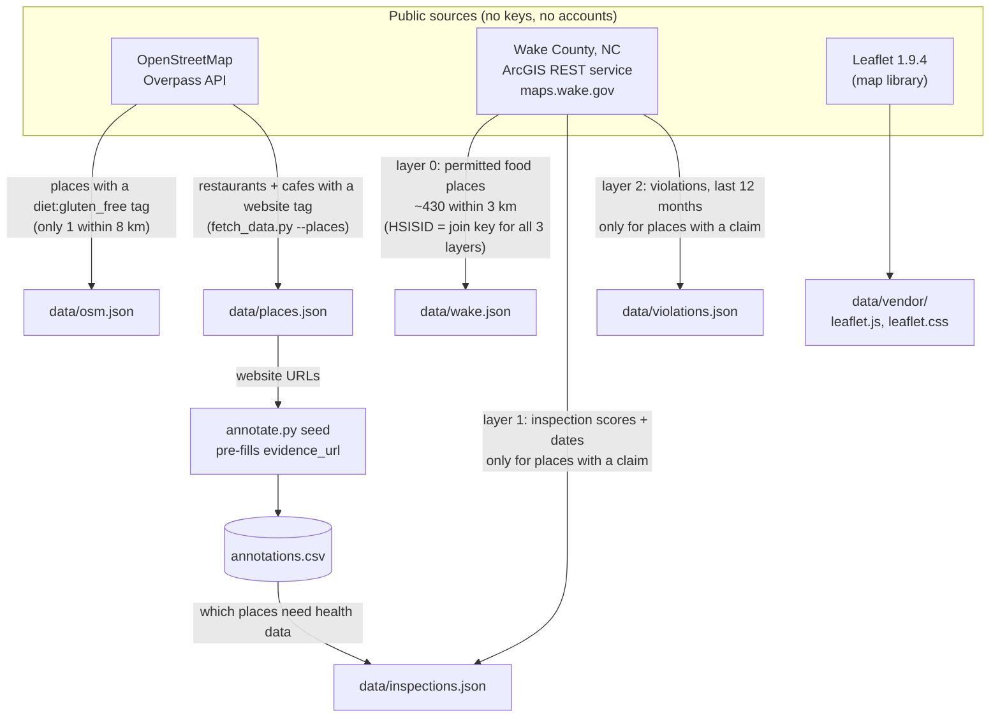
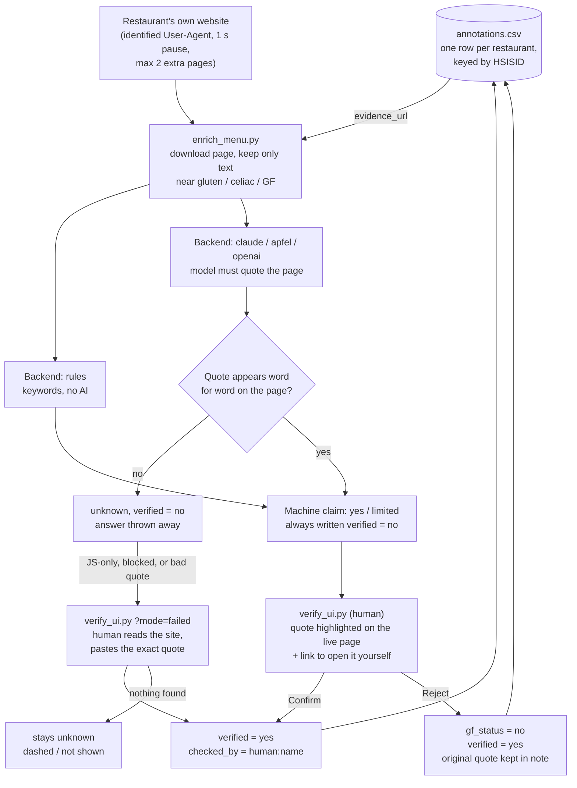
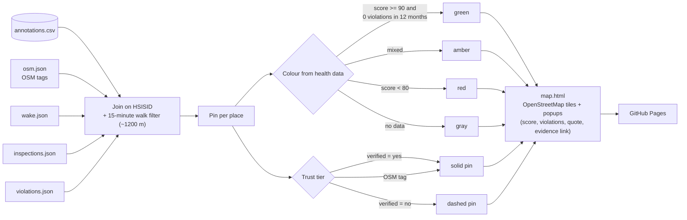
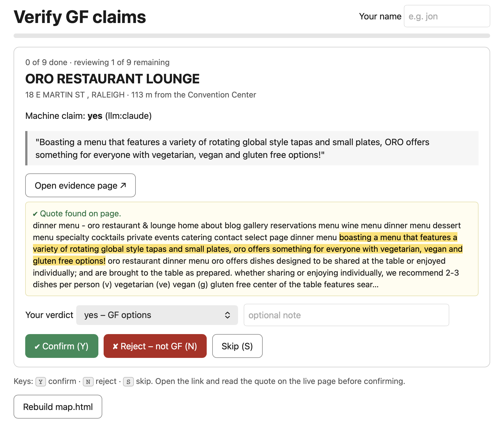

# Gluten-free restaurant finder (Raleigh)

Built at MLH Hacktoberfest Hacks @ All Things Open, 2026-10-19.

Finds allergy-friendly restaurants (starting with gluten-free) within a 15-minute walk of the
Raleigh Convention Center and pins them on an OpenStreetMap map, coloured by Wake County
health-inspection results. Every gluten-free claim shows its evidence and whether a human has checked it.

<https://rippy.github.io/ato_mlh_2026/scripts/map.html>

## The problem

Allergy-friendly food is hard to find, and the open data doesn't help:

- **OpenStreetMap has almost no gluten-free data.** Only 1 place within 8 km of the Convention Center has a
  `diet:gluten_free` tag.
- **Wake County publishes good health data**: ~430 permitted food places within 3 km, plus inspection
  scores and violations, joined by `HSISID`.

So the map needs an annotation layer on top of the open data. That layer is `scripts/annotations.csv`.

## How it works

### 1. Where the data comes from (`fetch_data.py`)

Everything is downloaded once, cached in `scripts/data/`, and committed, so the map builds offline.



OSM points are matched to county facilities by distance (<= 150 m) and name similarity (>= 0.6).

### 2. How a gluten-free claim gets made and checked



Re-running `enrich_menu.py --redo` only touches machine rows; human rows are never overwritten.

### 3. How the map is built (`gf_map.py`)



1. **Open data.** Restaurants from OpenStreetMap (Overpass) are matched to Wake County facilities by
   distance (<= 150 m) and name similarity. Inspection scores and the last 12 months of violations are
   pulled from the county ArcGIS service. Everything is cached in `scripts/data/`, so the map builds offline.
2. **Machine pass.** Keyword rules and an LLM (Claude Haiku via the `claude` CLI) read each restaurant's own
   website. Only text near "gluten / celiac / GF" is sent to a model. The model must quote the page, and the
   quote is checked word for word; if it isn't on the page the answer is thrown away.
   Machine output is always written `verified=no`.
3. **Human pass.** A small local web UI walks you through each machine claim: the quote, the surrounding page
   text with the quote highlighted, and a link to the live page. Only a human click sets `verified=yes`.
4. **Map.** Solid pins are human-verified, dashed pins are unverified. Pin colour comes from the health data.



### Current results

80 restaurants annotated near the Convention Center: **18 human-verified gluten-free places** (10 yes, 8 limited,
with cross-contact notes), 16 checked with nothing found, the rest not yet reviewed.

### Pin colours

| Colour | Meaning |
|---|---|
| Green | Score >= 90 and 0 violations in the last 12 months |
| Amber | Mixed |
| Red | Score < 80 |
| Gray | No inspection data |

Solid outline = human-verified. Dashed outline = unverified.

### Trust rules

- human-verified > OSM tag > unverified
- Machine output is never marked verified.
- Human rows are never overwritten by a re-run (`enrich_menu.py --redo` only touches machine rows).
- PDF or JavaScript-only menus become "unknown", not guesses.
- We are polite to restaurant sites: identified User-Agent, 1 second pause, at most 2 extra pages per site.

## Run it

Python 3 standard library plus `curl`. No installs. Data is already cached in the repo.

```
cd scripts
python3 gf_map.py                 # builds map.html from cached data
python3 -m http.server 8000       # open http://localhost:8000/map.html
```

OpenStreetMap tiles need a Referer header, so serve the map over http; `file://` won't show tiles.

Human verification UI:

```
cd scripts
python3 verify_ui.py              # open http://localhost:8001
                                  # http://localhost:8001/?mode=failed  = second pass for sites the AI couldn't read
```

Rebuild from scratch:

```
cd scripts
python3 fetch_data.py --places
python3 annotate.py seed --limit 60
python3 enrich_menu.py --backend rules
python3 enrich_menu.py --backend claude --redo --workers 3
python3 fetch_data.py && python3 gf_map.py
```

`enrich_menu.py` backends: `rules` (no AI), `claude`, `apfel` (on-device), `openai` (any OpenAI-compatible
endpoint, e.g. a local Ollama model via `LLM_BASE`).

## Repository layout

| Path | What it does |
|---|---|
| `scripts/fetch_data.py` | Downloads and caches OSM, Wake County and Leaflet data |
| `scripts/annotate.py` | Find, add, seed and list rows in `annotations.csv` |
| `scripts/enrich_menu.py` | Reads restaurant websites and proposes `gf_status` with a quote |
| `scripts/verify_ui.py` | Local web UI for human verification |
| `scripts/gf_map.py` | Joins everything and writes `map.html` |
| `scripts/annotations.csv` | The gluten-free claims: status, evidence URL, quote, who checked, when |
| `docs/EVENT_NOTES.md` | Raw notes from the day |
| `HANDOFF.md` | What worked, what didn't, and the demo story |

## What's next

- More allergens (nut, dairy, shellfish) using the same evidence-and-verification model.
- Pushing human-verified tags back to OpenStreetMap so everyone benefits.
- Volunteer annotation: the verification UI could run as a hosted page.
- An open-weight model (Ollama) for the machine pass.

## Team

Jonathan Rippy and Rebekah Callari-Kaczmarczyk.

## Licence and attribution

Code: MIT, see [LICENSE](LICENSE).

Data and libraries we use, and who owns them:

- **Map data and tiles:** (c) [OpenStreetMap](https://www.openstreetmap.org/copyright) contributors, available under the
  [Open Database Licence (ODbL)](https://opendatacommons.org/licenses/odbl/). Our cached `scripts/data/osm.json` is
  derived from OSM and stays under ODbL. Tiles are loaded from `tile.openstreetmap.org` under the
  [OSM tile usage policy](https://operations.osmfoundation.org/policies/tiles/).
- **Restaurants, health inspections and violations:** [Wake County, NC](https://data.wake.gov/) (Wake County GIS /
  Environmental Services), via the public ArcGIS REST service
  `maps.wake.gov/arcgis/rest/services/Inspections/RestaurantInspectionsOpenData`. Wake County publishes these under
  open-data terms that can differ per dataset, so check the dataset pages on data.wake.gov before reusing the data.
  We credit Wake County on the map and here. We have not changed the scores or violations.
- **Gluten-free claims:** taken from each restaurant's own public website (the evidence URL and quote are stored with
  every claim) and checked by a human on our team. Restaurant menus change, so confirm with the restaurant,
  especially if you have coeliac disease. This is not medical advice.
- **Map library:** [Leaflet](https://leafletjs.com/) 1.9.4, BSD 2-Clause, vendored in `scripts/data/vendor/`.
- **AI assistance:** Claude (Anthropic) read menu text, and its answers were kept only when the quote matched the page.
